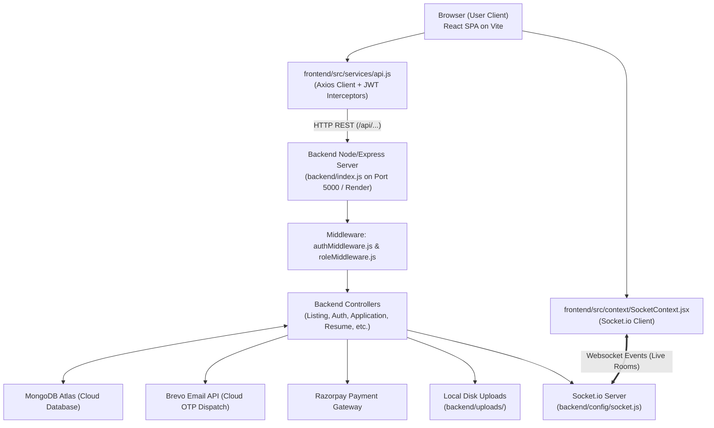
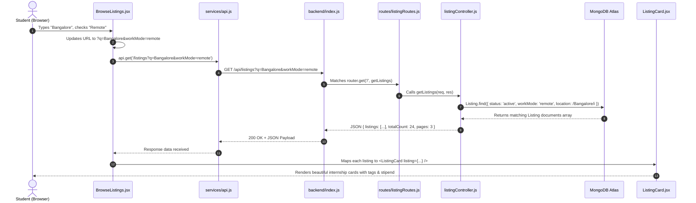
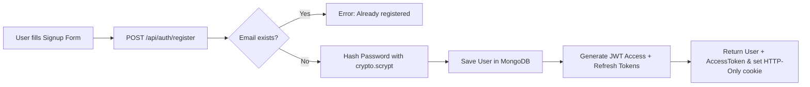
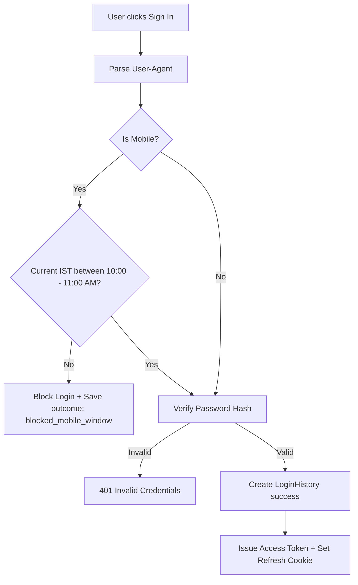
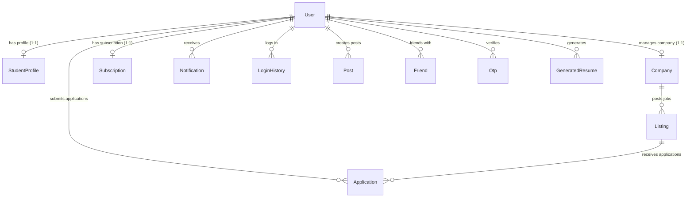

# InternConnect — Full Project Report & Architecture Guide

---

## 1. Project ek nazar me

**InternConnect** ek full-stack MERN (MongoDB, Express, React, Node.js) web application hai jo college students aur industry recruiters ko ek platform par jodta hai.

Is application ke do mukhya users hain:
1. **Student (Internship/Job Khojne Wale):** 
   - 250+ verified internship aur job opportunities browse, search aur filter kar sakte hain.
   - Apni complete academic profile bana sakte hain aur resume upload kar sakte hain.
   - One-click me jobs ke liye apply kar sakte hain aur live application status (applied, shortlisted, hired, rejected) track kar sakte hain.
   - Automated PDF Resume Builder use karke professional resume generate aur download kar sakte hain.
   - Subscription plans (Free, Bronze, Silver, Gold) ke zariye application limits manage kar sakte hain.
   - "Public Space" me doosre students se dosti (friend requests) kar sakte hain aur media posts/comments share kar sakte hain.

2. **Recruiter (Hiring Teams / Companies):**
   - Apni company ka verified profile (logo, description, size, location) setup kar sakte hain.
   - Nayi internships ya full-time jobs post aur manage kar sakte hain.
   - Har listing par aane wale applicants ka Kanban / status board dekh sakte hain aur unhe shortlist, reject ya hire kar sakte hain.
   - Automated skill-matching percentage ke zariye top candidates ko jaldi filter kar sakte hain.

Dono users ko real-time socket notifications, multiple languages (English, Hindi, Spanish, French, Portuguese, Chinese) aur secure authentication milta hai.

---

## 2. Tech stack aur kaun kya kaam karta hai

Neeche di gayi table me poora technical stack aur har technology ka role bataya gaya hai:

| Technology | Kahan use hui | Kaam (Short Description) |
| :--- | :--- | :--- |
| **React 18** | Frontend (`frontend/src`) | Component-based UI library jo single page application (SPA) banati hai. |
| **Vite** | Frontend Build Tool (`frontend/vite.config.js`) | Tez local development server aur production bundle generator. |
| **Tailwind CSS** | Frontend Styling (`frontend/tailwind.config.js`) | Utility-first CSS framework jisse modern, responsive aur sleek UI banti hai. |
| **React Router v6** | Frontend Routing (`frontend/src/App.jsx`) | Client-side page navigation bina browser reload kiye. |
| **i18next** | Frontend Localization (`frontend/src/i18n.js`) | 6 bhashaon (en, hi, es, fr, pt, zh) me website translate karne ke liye. |
| **Axios** | Frontend API Client (`frontend/src/services/api.js`) | Backend Express server ko HTTP requests bhejne aur interceptors handle karne ke liye. |
| **Socket.io Client** | Frontend Real-time (`frontend/src/context/SocketContext.jsx`) | Live notifications pane ke liye backend websocket server se connection. |
| **Lucide React** | Frontend Icons | Modern UI icons (Search, Briefcase, Bell, etc.). |
| **Node.js** | Backend Runtime (`backend/`) | JavaScript runtime environment jisme server chalta hai. |
| **Express.js** | Backend Framework (`backend/index.js`) | REST API endpoints, routing aur middleware chalane ke liye. |
| **MongoDB Atlas** | Database (Cloud) | Cloud NoSQL database jisme saara data (users, jobs, applications) JSON-like documents me save hota hai. |
| **Mongoose** | Backend ODM (`backend/models/`) | MongoDB documents ko define, validate aur query karne ke liye schema framework. |
| **JWT (jsonwebtoken)** | Authentication (`backend/controllers/authController.js`) | Access Token (15m) aur Refresh Token (7d) secure authentication ke liye. |
| **Helmet** | Backend Security (`backend/index.js`) | HTTP response headers secure karke common web vulnerabilities rokna. |
| **Express Rate Limit** | Backend Security (`backend/index.js`) | DDoS aur brute-force rokne ke liye API requests par limit lagana (200 req / 15 min). |
| **Multer** | File Uploads (`backend/middleware/uploadMiddleware.js`) | Resumes (PDF), company logos aur public space images/videos disk par save karna. |
| **PDFKit** | Backend Document Engine (`backend/controllers/resumeBuilderController.js`) | Server-side automated resume PDFs draw aur generate karne ke liye. |
| **Razorpay SDK** | Payment Gateway (`backend/controllers/subscriptionController.js`) | Subscriptions aur resume fees ke liye payment orders banana aur signature verify karna. |
| **Brevo API (Axios)** | Email Service (`backend/utils/mailer.js`) | Transactional OTP emails bhejne ke liye Brevo REST API v3 ka direct integration. |
| **Socket.io Server** | Backend Real-time (`backend/config/socket.js`) | User-specific rooms me live events emit karna. |
| **Vercel** | Frontend Hosting (`frontend/vercel.json`) | Frontend static build ko global CDN par deploy karna. |
| **Render** | Backend Hosting (`backend/`) | Node.js Express server ko cloud container me live chalana. |

---

## 3. Folder structure

Project ka poora folder structure aur har file/folder ka ek-line kaam:

```
InternConnect-main/
├── vercel.json                        # Root Vercel routing rules (monorepo support)
├── start.bat                          # Windows batch script jisse frontend + backend dono ek click me start hote hain
├── .gitignore                         # Git exclusion rules (node_modules, uploads, .env)
│
├── backend/                           # Node.js + Express API Backend
│   ├── package.json                   # Backend dependencies aur scripts (npm start, npm run dev)
│   ├── index.js                       # Server entry point: Express app, middleware, routes mount, Atlas connection aur seeder
│   │
│   ├── config/                        # Server Configuration
│   │   ├── db.js                      # MongoDB Atlas mongoose connection logic (with retry aur fail-safe)
│   │   ├── socket.js                  # Socket.io initialize aur event handlers (user rooms join/leave)
│   │   └── indianData.js              # Sample data generator (50+ Indian companies, 250+ listings)
│   │
│   ├── controllers/                   # Business Logic Handlers
│   │   ├── applicationController.js   # Apply karna, student applications dekhna, recruiter status update (shortlist/hire/reject)
│   │   ├── authController.js          # Register, login, refresh token, logout, mobile 10-11 AM IST validation
│   │   ├── friendController.js        # Public space friend requests (send, accept, reject, unfriend, stats)
│   │   ├── listingController.js       # Internships browse, filter, search, recruiter create/edit/delete/close
│   │   ├── loginHistoryController.js  # User device, browser, IP aur login attempts ka audit trail
│   │   ├── notificationController.js  # In-app notifications fetch aur mark-as-read karna
│   │   ├── otpController.js           # French language switch aur resume payment ke liye OTP generate aur verify karna
│   │   ├── postController.js          # Public space posts banana, like karna, comment, pin comment aur share
│   │   ├── recruiterController.js     # Recruiter company profile setup, update aur logo upload
│   │   ├── resumeBuilderController.js # Resume data save karna, PDFKit se PDF generate karna, payment order verify karna
│   │   ├── studentController.js       # Student profile manage karna, resume PDF upload, listings bookmark karna
│   │   └── subscriptionController.js  # Subscription plans (Free, Bronze, Silver, Gold) fetch aur Razorpay checkout
│   │
│   ├── middleware/                    # Request Interceptor Middlewares
│   │   ├── authMiddleware.js          # JWT access token verify karke req.user me userId aur role daalta hai
│   │   ├── roleMiddleware.js          # Role-based access control (RBAC): sirf 'student' ya 'recruiter' ko allow karta hai
│   │   └── uploadMiddleware.js        # Multer config: resume, logo aur post media file storage aur file-type validation
│   │
│   ├── models/                        # Mongoose Database Schemas
│   │   ├── index.js                   # Saare 12 Mongoose models ka single clean export point
│   │   ├── Application.js             # Student job application schema (with unique compound index)
│   │   ├── Company.js                 # Recruiter company schema
│   │   ├── Friend.js                  # User-to-user friend connection schema
│   │   ├── GeneratedResume.js         # Resume Builder data aur output PDF file link schema
│   │   ├── Listing.js                 # Internship & job opportunity schema
│   │   ├── LoginHistory.js            # Login security audit trail schema
│   │   ├── Notification.js            # In-app notification schema
│   │   ├── Otp.js                     # 6-digit verification code schema (with expiry)
│   │   ├── Post.js                    # Public Space social post schema (media, likes, comments)
│   │   ├── StudentProfile.js          # Student academic, skills, experience aur resume schema
│   │   ├── Subscription.js            # Monthly application quota aur paid tier schema
│   │   └── User.js                    # Core user schema (email, password hash, role, preferredLanguage)
│   │
│   ├── routes/                        # Express API Route Definitions
│   │   ├── applicationRoutes.js       # Endpoints: /api/applications/*
│   │   ├── authRoutes.js              # Endpoints: /api/auth/*
│   │   ├── friendRoutes.js            # Endpoints: /api/friends/*
│   │   ├── listingRoutes.js           # Endpoints: /api/listings/*
│   │   ├── loginHistoryRoutes.js      # Endpoints: /api/login-history/*
│   │   ├── notificationRoutes.js      # Endpoints: /api/notifications/*
│   │   ├── otpRoutes.js               # Endpoints: /api/otp/*
│   │   ├── postRoutes.js              # Endpoints: /api/posts/*
│   │   ├── recruiterRoutes.js         # Endpoints: /api/companies/*
│   │   ├── resumeBuilderRoutes.js     # Endpoints: /api/resume-builder/*
│   │   ├── studentRoutes.js           # Endpoints: /api/students/*
│   │   └── subscriptionRoutes.js      # Endpoints: /api/subscriptions/*
│   │
│   ├── utils/                         # Helper Utilities
│   │   ├── mailer.js                  # Brevo API email dispatcher (OTP aur system emails)
│   │   ├── passwordGenerator.js       # Random temporary password generation helper
│   │   └── timeUtils.js               # IST time calculation aur 10:00-11:00 AM mobile window rule
│   │
│   └── uploads/                       # User uploaded files (resumes, logos, post images/videos)
│
└── frontend/                          # React + Vite Frontend
    ├── package.json                   # Frontend dependencies aur scripts
    ├── vite.config.js                 # Vite build aur dev server settings
    ├── tailwind.config.js             # Tailwind CSS theme customization
    ├── postcss.config.js              # PostCSS plugins config
    ├── vercel.json                    # Single Page App rewrite rule (`/index.html`)
    ├── index.html                     # HTML root page
    │
    ├── public/                        # Static Public Assets
    │   ├── favicon.svg                # Browser tab icon
    │   └── icons.svg                  # Vector SVG sprite
    │
    └── src/                           # Frontend Source Code
        ├── main.jsx                   # React DOM root render + ThemeProvider wrap
        ├── App.jsx                    # Core router, page routes layout aur role-protected gates
        ├── index.css                  # Global styles, Tailwind directives aur animations
        ├── i18n.js                    # i18next configuration (6 languages loader)
        │
        ├── assets/                    # Static Images
        │   └── elevanceskills_logo.png # ElevanceSkills brand logo
        │
        ├── components/                # Reusable UI Components
        │   ├── Navbar.jsx             # Top navigation bar with language picker, notifications, profile menu
        │   ├── Footer.jsx             # Platform footer with brand info aur links
        │   ├── ProtectedRoute.jsx     # Route guard jo unauthenticated ya unauthorized users ko redirect karta hai
        │   ├── MobileAccessBlocker.jsx # 10:00-11:00 AM IST mobile access blocker wrapper
        │   ├── MockPaymentQR.jsx      # Test payment QR modal component (Razorpay test fallback)
        │   ├── AutocompleteInput.jsx  # Smart search dropdown for locations and skills
        │   ├── SkeletonLoader.jsx     # Loading shimmer skeletons for listings and job details
        │   ├── ExploreOpportunities.jsx # Top category discovery showcase cards
        │   ├── DeveloperCredit.jsx    # Developer attribution badge
        │   ├── StudentDashboardLive.jsx # Student dashboard live view component
        │   │
        │   ├── auth/
        │   │   └── AuthCharacters.jsx # Interactive cartoon characters jo cursor aur input track karte hain
        │   ├── listings/
        │   │   ├── FilterSidebar.jsx  # Category, work mode, stipend filter sidebar
        │   │   └── ListingCard.jsx    # Internship card with tags, stipend, company logo and save button
        │   └── navbar/
        │       ├── LanguageSwitcher.jsx # 6-language dropdown (with French OTP modal)
        │       ├── navLinks.js        # Nav link configurations based on role
        │       ├── NotificationBell.jsx # Live notification badge aur dropdown pane
        │       └── ProfileMenu.jsx    # User dropdown with role badge, profile, login history, logout
        │
        ├── context/                   # React State Contexts
        │   ├── AuthContext.jsx        # User authentication state (user, login, logout, register, refresh)
        │   ├── SocketContext.jsx      # Real-time websocket connection provider
        │   └── ThemeContext.jsx       # Theme state provider
        │
        ├── hooks/                     # Custom React Hooks
        │   ├── useDebounce.js         # Debounce hook for rapid input keystrokes
        │   └── useClickOutside.js     # Dropdown auto-close on clicking outside
        │
        ├── locales/                   # Translation JSON Dictionaries
        │   ├── en/translation.json    # English
        │   ├── hi/translation.json    # Hindi
        │   ├── es/translation.json    # Spanish
        │   ├── fr/translation.json    # French
        │   ├── pt/translation.json    # Portuguese
        │   └── zh/translation.json    # Chinese
        │
        ├── pages/                     # Full Page Views
        │   ├── LandingPage.jsx        # Public homepage: hero banner, popular categories, featured jobs
        │   ├── BrowseListings.jsx     # Full listings catalog with URL query sync, search and filters
        │   ├── ListingDetail.jsx      # Individual job view with requirements, company details, apply action
        │   ├── AuthPage.jsx           # Clean unified Login / Signup tabbed page with cartoon animations
        │   ├── ForgotPassword.jsx     # Password reset request form
        │   ├── StudentDashboard.jsx   # Student overview: applied count, shortlisted, saved jobs, live widgets
        │   ├── StudentProfile.jsx     # Student academic details, skill tags, resume file upload
        │   ├── MyApplications.jsx     # List of all internships student has applied for with live status
        │   ├── BookmarkedJobs.jsx     # Saved internship listings with quick apply links
        │   ├── RecruiterDashboard.jsx # Recruiter portal: active listings, applicants count, new job button
        │   ├── PostListing.jsx        # Form to publish a new internship or job opportunity
        │   ├── CompanyProfile.jsx     # Recruiter enterprise profile setup and logo upload
        │   ├── ApplicantTracker.jsx   # Kanban / list of applicants per job with skill-match % and status updater
        │   ├── PublicSpace.jsx        # Community feed: photo/video posts, comments, likes, friend requests
        │   ├── Subscription.jsx       # Student subscription pricing cards and Razorpay checkout
        │   ├── ResumeBuilder.jsx      # Professional multi-section resume builder + PDF generator + payment
        │   ├── LoginHistory.jsx       # User security log showing past login dates, device types, browser, IP
        │   └── Help.jsx               # Comprehensive Help Center & FAQ accordion
        │
        └── services/
            └── api.js                 # Axios instance with baseURL auto-switch, JWT attachment & silent 401 token refresh
```

---

## 4. Poora system kaise judta hai (big picture)

### Architecture Diagram



### Text / ASCII Version
```
[ User Browser ]
       |
       +---> [ frontend/src/services/api.js ] (Axios Instance)
       |            |
       |            |  HTTP Requests (/api/...) + Bearer AccessToken
       |            v
       |     [ backend/index.js (Express Server) ]
       |            |
       |            +---> [ Middleware: Helmet, CORS, RateLimit, Auth, Role ]
       |            |
       |            +---> [ Controllers (Auth, Listing, Application, Resume...) ]
       |            |            |
       |            |            +---> [ MongoDB Atlas ] (Persistent Data)
       |            |            +---> [ Brevo API ] (OTP Emails)
       |            |            +---> [ Razorpay ] (Payments)
       |            |            +---> [ Local Disk /uploads ] (PDFs & Media)
       |            |
       |            +---> [ Socket.io Server (backend/config/socket.js) ]
       |                         ^
       +---> [ SocketContext.jsx ]<+ (Live bidirectional Websocket connection)
```

### Localhost vs Production Deployed Environment me Backend Address Kaise Milta Hai?
File: [`frontend/src/services/api.js`](file:///c:/my_data/projects/InternConnect-main/InternConnect-main/frontend/src/services/api.js)

1. **Localhost Development:**
   Jab user browser me `http://localhost:5173` ya `http://127.0.0.1:5173` kholta hai:
   `api.js` ka `getApiBaseUrl()` check karta hai ki hostname `localhost` ya local IP hai.
   Agar haan, to API URL automatically `http://<host>:5000/api` ban jata hai.
   Is wajah se developer ko baar-baar URL badalne ki zaroorat nahi padti.

2. **Production Deployed (Vercel + Render):**
   Jab frontend Vercel par live hota hai (jaise `*.vercel.app`):
   Hostname `localhost` nahi hota, isliye `api.js` automatically production backend URL (`https://internconnect-backend-jhn6.onrender.com/api`) par request bhejta hai.
   Agar user `.env` me `VITE_API_URL` pass kare to wo sabse pehle prioritize hota hai.

---

## 5. Ek request ka safar (step by step)

Example Case: **"User `/browse` page par jakar Bangalore ki Remote internships search karta hai"**



### Text / ASCII Version
```
[Student in Browser]
   |
   | (1) Types filters in UI: "Bangalore", "Remote"
   v
[BrowseListings.jsx]
   | (2) Updates browser query params: ?q=Bangalore&workMode=remote
   | (3) Calls Axios: api.get('/listings?q=Bangalore&workMode=remote')
   v
[frontend/src/services/api.js]
   | (4) Attaches Authorization header if user logged in
   | (5) Sends HTTP GET to http://localhost:5000/api/listings?...
   v
[backend/index.js -> backend/routes/listingRoutes.js]
   | (6) Matches route: router.get('/', listingController.getListings)
   v
[backend/controllers/listingController.js]
   | (7) Extracts req.query: { q: 'Bangalore', workMode: 'remote' }
   | (8) Builds Mongoose query with regex and filters
   v
[MongoDB Atlas]
   | (9) Executes query on 'listings' collection
   | (10) Returns matched array of documents
   v
[listingController.js]
   | (11) Sends HTTP 200 JSON: { listings: [...], count: 24 }
   v
[BrowseListings.jsx -> ListingCard.jsx]
   | (12) State update triggers re-render
   | (13) Student ko internship cards screen par dikhte hain!
```

---

## 6. Mukhya flows (step-by-step, files, diagrams)

### a. Signup Flow
- **Files:** `frontend/src/pages/AuthPage.jsx`, `frontend/src/context/AuthContext.jsx`, `backend/routes/authRoutes.js`, `backend/controllers/authController.js`, `backend/models/User.js`.
- **Kaise Kaam Karta Hai:**
  1. User role choose karta hai (`student` ya `recruiter`), phir naam, email, password enter karta hai.
  2. `AuthContext.jsx` ka `register()` function `POST /api/auth/register` call karta hai.
  3. `authController.js` check karta hai ki email already registered hai ya nahi.
  4. Password ko salt ke saath hash kiya jata hai (`crypto.scryptSync`).
  5. MongoDB me `User` document banta hai. Student ke case me free `Subscription` record bhi auto-create hota hai.
  6. Access Token aur Refresh Token generate hote hain. Refresh token HTTP-Only cookie me set hota hai, access token JSON response me user details ke saath return hota hai.


```
[User Form] -> [POST /api/auth/register] -> [Hash Password] -> [Save to Mongo] -> [Issue JWTs] -> [LoggedIn Dashboard]
```

---

### b. Login Flow (with Mobile IST Rule & Login History)
- **Files:** `frontend/src/pages/AuthPage.jsx`, `frontend/src/components/MobileAccessBlocker.jsx`, `backend/controllers/authController.js`, `backend/utils/timeUtils.js`, `backend/models/LoginHistory.js`.
- **Kaise Kaam Karta Hai:**
  1. UserAgent parse hota hai: device `mobile`, `desktop`, ya `laptop` detect hota hai.
  2. **Mobile IST Rule:** Agar device mobile hai, to `authController.js` aur `timeUtils.js` check karte hain ki kya abhi Indian Standard Time (IST) ka **10:00 AM se 11:00 AM** window chal raha hai. Agar is window ke bahar login attempt hota hai, to login block kar diya jata hai:
     `outcome: 'blocked_mobile_window'`, error: "Mobile logins are only permitted between 10:00 AM and 11:00 AM IST."
  3. Agar desktop hai ya 10-11 AM IST ka time hai, to password verify hota hai.
  4. Login attempt chahe fail ho ya pass, `LoginHistory` collection me device, OS, browser, IP address aur outcome save hota hai.
  5. Success par JWT Access Token (15 min) aur Refresh Token (7 days, HTTP-Only Cookie) generate hote hain.


```
[Sign In] -> [Check Device & Time] -> [If Mobile & not 10-11 AM IST => Blocked]
                                   -> [If Allowed => Verify Password]
                                   -> [Log in LoginHistory]
                                   -> [Issue Tokens]
```

---

### c. Session kaise bani rehti hai (AuthContext, Refresh, Logout)
- **Files:** `frontend/src/context/AuthContext.jsx`, `frontend/src/services/api.js`, `backend/routes/authRoutes.js`, `backend/controllers/authController.js`.
- **Kaise Kaam Karta Hai:**
  1. Access token ki validity 15 minute hoti hai (localStorage me save rehta hai).
  2. Har request par Axios interceptor `Authorization: Bearer <accessToken>` bhejta hai.
  3. Jab 15 minute baad token expire hota hai, backend `401 Unauthorized` bhejta hai.
  4. Axios interceptor request ko fail nahi hone deta: wo request ko queue me daal kar silently `POST /api/auth/refresh` bhejta hai (jisme browser automatically HTTP-Only refresh cookie bhejta hai).
  5. Backend cookie verify karke naya Access Token return karta hai.
  6. Axios naya token localStorage me save karta hai aur ruki hui original request ko retry kar deta hai. User ko koi interruption nahi dikhta!
  7. **Logout:** User logout par click karta hai to `POST /api/auth/logout` refresh cookie clear karta hai, localStorage se access token hat jaata hai, aur user landing page par redirect ho jaata hai.

---

### d. Internships Browse, Filter aur Search
- **Files:** `frontend/src/pages/BrowseListings.jsx`, `frontend/src/components/listings/FilterSidebar.jsx`, `frontend/src/components/listings/ListingCard.jsx`, `backend/controllers/listingController.js`.
- **Kaise Kaam Karta Hai:**
  1. URL parameters (`?q=react&workMode=remote&minStipend=10000&category=Engineering`) single source of truth hain.
  2. Filter change karne par `setSearchParams` URL update karta hai.
  3. Backend MongoDB query banata hai: `$regex` se title aur skills search hoti hain, `stipendMax >= minStipend`, aur pagination limit 12 chalti hai.
  4. Response aane par skeleton shimmer hat kar listing cards render hote hain.

---

### e. Apply Karna (Resume Snapshot & Duplicate Prevention)
- **Files:** `frontend/src/pages/ListingDetail.jsx`, `backend/controllers/applicationController.js`, `backend/models/Application.js`, `backend/models/StudentProfile.js`.
- **Kaise Kaam Karta Hai:**
  1. Student listing details page par "Apply Now" click karta hai.
  2. Backend check karta hai ki student ka profile complete hai aur resume uploaded hai.
  3. **Resume Snapshot:** Student ka current resume URL application me snapshot ke roop me permanently save hota hai (`resumeUrlSnapshot`), taaki agar student baad me profile me resume badal bhi le, recruiter ko wahi version mile jo apply karte waqt tha!
  4. **Duplicate Prevention:** MongoDB me `{ listingId: 1, studentId: 1 }` ka unique compound index hai. Agar student dobara apply karne ki koshish kare, to MongoDB E11000 duplicate key error deta hai aur backend `409 Conflict: Already applied` return karta hai.
  5. Application banne par listing ka `applicantCount` +1 ho jata hai aur recruiter ko real-time socket notification bheja jata hai.

---

### f. Recruiter: Company Profile, Listing Post, Applicants Kanban Board
- **Files:** `frontend/src/pages/CompanyProfile.jsx`, `frontend/src/pages/PostListing.jsx`, `frontend/src/pages/ApplicantTracker.jsx`, `backend/controllers/recruiterController.js`, `backend/controllers/applicationController.js`.
- **Kaise Kaam Karta Hai:**
  1. Recruiter company name, website, industry aur logo upload karta hai (`POST /api/companies/me/logo`).
  2. Job post karne ke liye title, description, skills required, stipend range aur duration bharta hai (`POST /api/listings`).
  3. **Applicant Tracker:** Job ke har applicant ka record Kanban ya list me dikhta hai.
  4. **Smart Match %:** Frontend candidate ke skills aur job requirements ke common matches calculate karke score (e.g. 85% match) dikhata hai.
  5. Recruiter status badal sakta hai: `shortlisted`, `rejected`, `hired`. Status badalte hi student ko socket notification milta hai.

---

### g. Notifications System (Socket.io Rooms)
- **Files:** `frontend/src/context/SocketContext.jsx`, `frontend/src/components/navbar/NotificationBell.jsx`, `backend/config/socket.js`, `backend/controllers/notificationController.js`, `backend/models/Notification.js`.
- **Kaise Kaam Karta Hai:**
  1. Login hote hi frontend websocket connect karta hai aur `join-user-room` emit karta hai jisse user apne private room (`user:<userId>`) me jud jata hai.
  2. Jab koi event hota hai (jaise nayi application aana, status shortlist hona, friend request), backend pehle MongoDB me `Notification` document create karta hai.
  3. Phir Socket.io se `io.to('user:<recipientId>').emit('new-notification', payload)` bhejta hai.
  4. Frontend ke bell icon par unread count ka red badge turnt show hota hai bina page refresh kiye.
  5. Bell click karke user notification ko "read" mark kar sakta hai (`PATCH /api/notifications/:id/read`).

---

### h. Public Space (Community Feed & Friends)
- **Files:** `frontend/src/pages/PublicSpace.jsx`, `backend/controllers/postController.js`, `backend/controllers/friendController.js`, `backend/models/Post.js`, `backend/models/Friend.js`.
- **Kaise Kaam Karta Hai:**
  1. Students aur recruiters photo/video aur caption ke saath posts publish kar sakte hain.
  2. Users posts par like, comment, comment pin, aur WhatsApp/LinkedIn/Twitter share links trigger kar sakte hain.
  3. **Friends System:** Doosre users ko search karke Friend Request bhej sakte hain. Recipient `accept` ya `reject` kar sakta hai. Live statistics (Total Friends, Pending Requests) dikhte hain.

---

### i. Subscription / Payment System (Razorpay & Mock Mode)
- **Files:** `frontend/src/pages/Subscription.jsx`, `frontend/src/components/MockPaymentQR.jsx`, `backend/controllers/subscriptionController.js`, `backend/models/Subscription.js`.
- **Kaise Kaam Karta Hai:**
  1. Plans: Free (10 applications/month), Bronze (30 apps, ₹199), Silver (75 apps, ₹499), Gold (Unlimited apps, ₹999).
  2. Jab user plan choose karta hai, `POST /api/subscriptions/create-order` call hota hai.
  3. **Mock Mode Kab Chalta Hai:** Agar `.env` me `MOCK_PAYMENTS === 'true'` ho ya `RAZORPAY_KEY_ID` set na ho, to system production Razorpay crash karne ke bajaye "Mock Mode" me run hota hai. Frontend par demo QR code popup hota hai jisme simulated payment button hota hai.
  4. Production Mode me live Razorpay Checkout modal khulta hai aur signature crypto HMAC se verify hoti hai.
  5. Verify hone par subscription active ho jati hai aur limits update ho jati hain.

---

### j. Resume Builder System (Premium Check, Payment OTP, PDFKit Engine)
- **Files:** `frontend/src/pages/ResumeBuilder.jsx`, `backend/controllers/resumeBuilderController.js`, `backend/models/GeneratedResume.js`.
- **Kaise Kaam Karta Hai:**
  1. Student 6 sections bharta hai: Personal info, Education, Experience, Skills, Projects, Certifications.
  2. **Payment OTP Rule:** Final resume generate karne se pehle ₹49 fee ya OTP verification step require hota hai.
  3. **Server-Side PDFKit Engine:** Backend par `pdfkit` library document initialize karti hai, clean typography, dynamic layout, borders, bullet points draw karti hai, aur PDF file `backend/uploads/` me stream karke save karti hai.
  4. Response me direct download link milta hai jisse student high-resolution PDF download kar sake.

---

### k. Language System (i18n): 6 Languages & French OTP Rule
- **Files:** `frontend/src/i18n.js`, `frontend/src/components/navbar/LanguageSwitcher.jsx`, `backend/controllers/authController.js`.
- **Kaise Kaam Karta Hai:**
  1. 6 languages support hain: English (`en`), Hindi (`hi`), Spanish (`es`), French (`fr`), Portuguese (`pt`), Chinese (`zh`).
  2. User navbar se language choose karta hai to i18next instant dictionary switch karta hai aur backend ko `PATCH /api/auth/update-language` bhejta hai.
  3. **French OTP Rule:** Assignment requirement ke tahat, agar user French (`fr`) language select karta hai, to direct switch nahi hota! Ek security popup khulta hai jisme user ke registered email par OTP bheja jata hai. OTP sahi verify hone ke baad hi language French me badalti hai.

---

### l. OTP System: Brevo Email Dispatch & Verification
- **Files:** `backend/controllers/otpController.js`, `backend/routes/otpRoutes.js`, `backend/models/Otp.js`, `backend/utils/mailer.js`.
- **Kaise Kaam Karta Hai:**
  1. System me 2 valid OTP purposes active hain:
     - `language_change_fr`: French language switch verification.
     - `resume_payment`: Resume Builder checkout verification.
  2. **Dispatch:** `POST /api/otp/send` 6-digit random code generate karta hai, MongoDB me 10-minute expiry ke sath save karta hai, aur Brevo API ke zariye email bhejta hai (asynchronously, taaki UI instant respond kare).
  3. **Rate Limit:** Agar user 15 second ke andar dobara click kare, to SMTP spam rokne ke liye wahi code reuse hota hai.
  4. **Verification:** `POST /api/otp/verify` code match karta hai. Match hone par OTP delete ho jata hai aur `verified: true` return hota hai.

---

### m. Sample Data Seeder Flow
- **Files:** `backend/index.js` (lines 100-210), `backend/config/indianData.js`.
- **Kaise Kaam Karta Hai:**
  1. Backend start hote hi MongoDB se check karta hai: `await Listing.countDocuments()`.
  2. Agar database poori tarah empty ho (`count === 0`), to automatic seeder start hota hai:
     - 2 demo recruiter accounts banta hai (`recruiter@techcorp.com`, `hiring@designlabs.co`).
     - 50 top Indian companies create karta hai (CRED, Swiggy, Razorpay, Zomato, Flipkart, Infosys, TCS, etc.).
     - 250+ realistic Indian internship aur job listings create karta hai (Bangalore, Pune, Mumbai, Hyderabad, Delhi NCR, Remote).
  3. Agar database me pehle se data maujood ho (jaise abhi 268 listings hain), to seeder quietly skip ho jata hai.

---

## 7. Database models

Mongoose schemas jo `backend/models/` me define hain:

### Entity Relationship Diagram (ERD)



### Text / ASCII ERD
```
[ User ]
   |-- (1:1) ---> [ StudentProfile ] (Skills, College, Bio, ResumeUrl)
   |-- (1:1) ---> [ Company ] (CompanyName, LogoUrl, Location)
   |-- (1:1) ---> [ Subscription ] (Plan: free/bronze/silver/gold, Quota)
   |-- (1:N) ---> [ Application ] (ListingId, Status, ResumeSnapshot)
   |-- (1:N) ---> [ Notification ] (Message, Type, Read)
   |-- (1:N) ---> [ LoginHistory ] (Browser, OS, Device, Outcome, IP)
   |-- (1:N) ---> [ Post ] (MediaUrl, Likes, Comments)
   |-- (1:N) ---> [ Friend ] (RequesterId, RecipientId, Status)
   |-- (1:N) ---> [ Otp ] (Code, Purpose, ExpiresAt)
   |-- (1:N) ---> [ GeneratedResume ] (Education, Projects, PDFUrl)

[ Company ]
   |-- (1:N) ---> [ Listing ] (Title, Type, Stipend, Skills, Status)
                       |
                       +-- (1:N) ---> [ Application ]
```

### Model Descriptions

1. **User (`backend/models/User.js`):**
   - Core identity model.
   - Main Fields: `name`, `email` (unique), `password` (hashed), `role` (`student` | `recruiter`), `preferredLanguage`, `firebaseUid`.
   - Juda Hai: Saare doosre models se (Foreign Key / ObjectId).

2. **StudentProfile (`backend/models/StudentProfile.js`):**
   - Student ki academic aur professional details.
   - Main Fields: `userId`, `college`, `degree`, `graduationYear`, `skills` (array), `location`, `bio`, `resumeUrl`, `savedListings`.
   - Juda Hai: `User`, `Listing`.

3. **Company (`backend/models/Company.js`):**
   - Recruiter ki registered company.
   - Main Fields: `userId`, `companyName`, `logoUrl`, `website`, `industry`, `companySize`, `location`, `description`.
   - Juda Hai: `User`.

4. **Listing (`backend/models/Listing.js`):**
   - Internship aur full-time job posts.
   - Main Fields: `companyId`, `title`, `category`, `type` (`internship` | `job`), `workMode` (`remote` | `hybrid` | `onsite`), `location`, `stipendMin`, `stipendMax`, `durationMonths`, `skillsRequired`, `status` (`active` | `closed`), `applicantCount`.
   - Juda Hai: `Company`.

5. **Application (`backend/models/Application.js`):**
   - Student application submission.
   - Main Fields: `listingId`, `studentId`, `resumeUrlSnapshot`, `coverNote`, `status` (`applied` | `shortlisted` | `rejected` | `hired`).
   - Juda Hai: `Listing`, `User`. Unique Compound Index: `{ listingId: 1, studentId: 1 }`.

6. **Notification (`backend/models/Notification.js`):**
   - Real-time in-app alerts.
   - Main Fields: `userId`, `type` (`new_application`, `status_change`, `friend_request`, `friend_accepted`), `message`, `read`, `relatedId`.
   - Juda Hai: `User`, `Listing`.

7. **Friend (`backend/models/Friend.js`):**
   - Public Space peer networking.
   - Main Fields: `requesterId`, `recipientId`, `status` (`pending`, `accepted`, `rejected`).
   - Juda Hai: `User` (requester), `User` (recipient).

8. **Post (`backend/models/Post.js`):**
   - Public Space feed posts.
   - Main Fields: `userId`, `mediaUrl`, `mediaType` (`image` | `video`), `caption`, `likes` (array of userIds), `comments` (array with text, userId, pinned), `shareCount`.
   - Juda Hai: `User`.

9. **Subscription (`backend/models/Subscription.js`):**
   - Student application quota tracking.
   - Main Fields: `userId`, `planName` (`free`, `bronze`, `silver`, `gold`), `applicationsUsedThisMonth`, `cycleStartDate`, `razorpayPaymentId`, `status`.
   - Juda Hai: `User`.

10. **Otp (`backend/models/Otp.js`):**
    - One-time verification codes.
    - Main Fields: `userId`, `code`, `purpose` (`resume_payment`, `language_change_fr`), `expiresAt`.
    - Juda Hai: `User`.

11. **GeneratedResume (`backend/models/GeneratedResume.js`):**
    - Resume Builder state aur output file.
    - Main Fields: `userId`, `fullName`, `personalInfo`, `education`, `experience`, `skills`, `projects`, `generatedPdfUrl`.
    - Juda Hai: `User`.

12. **LoginHistory (`backend/models/LoginHistory.js`):**
    - Security audit log.
    - Main Fields: `userId`, `browser`, `os`, `deviceType` (`desktop`, `laptop`, `mobile`), `ipAddress`, `outcome` (`success`, `blocked_mobile_window`), `loginAt`.
    - Juda Hai: `User`.

---

## 8. API endpoints ki table

| Method | URL | Login Chahiye? | Allowed Role | Controller Function | Kaam (Description) |
| :--- | :--- | :--- | :--- | :--- | :--- |
| **POST** | `/api/auth/register` | No | Any | `authController.register` | Naya student ya recruiter account banana |
| **POST** | `/api/auth/login` | No | Any | `authController.login` | Credentials check karna, mobile IST rule lagana aur tokens issue karna |
| **POST** | `/api/auth/refresh` | No (Cookie) | Any | `authController.refresh` | Refresh token cookie se naya access token lena |
| **POST** | `/api/auth/logout` | Yes | Any | `authController.logout` | User refresh token cookie clear karna |
| **POST** | `/api/auth/forgot-password` | No | Any | `authController.forgotPassword` | Temporary password reset request |
| **PATCH** | `/api/auth/update-language` | Yes | Any | `authController.updateLanguage` | User ki preferred language save karna |
| **GET** | `/api/listings` | No | Public | `listingController.getListings` | Search, filter aur pagination ke saath active jobs lana |
| **GET** | `/api/listings/suggestions` | No | Public | `listingController.getSuggestions` | Autocomplete input ke liye title/city suggestions |
| **GET** | `/api/listings/:id` | No | Public | `listingController.getListingById` | Single internship ki complete details aur company info |
| **POST** | `/api/listings` | Yes | Recruiter | `listingController.createListing` | Nayi internship ya job publish karna |
| **PUT** | `/api/listings/:id` | Yes | Recruiter | `listingController.updateListing` | Existing listing ke details update karna |
| **DELETE** | `/api/listings/:id` | Yes | Recruiter | `listingController.deleteListing` | Listing delete karna |
| **PATCH** | `/api/listings/:id/close` | Yes | Recruiter | `listingController.closeListing` | Listing status ko 'closed' karna |
| **GET** | `/api/listings/recruiter/me` | Yes | Recruiter | `listingController.getRecruiterListings` | Recruiter ki apni post ki hui saari listings lana |
| **POST** | `/api/applications` | Yes | Student | `applicationController.applyToListing` | Internship ke liye resume snapshot ke sath apply karna |
| **GET** | `/api/applications/student/me` | Yes | Student | `applicationController.getStudentApplications` | Student ki apni saari applied applications dekhna |
| **DELETE** | `/api/applications/:id` | Yes | Student | `applicationController.withdrawApplication` | Submitted application withdraw / cancel karna |
| **GET** | `/api/applications/listing/:id` | Yes | Recruiter | `applicationController.getListingApplications` | Job ke saare applicants aur unke resume dekhna |
| **PATCH** | `/api/applications/:id/status` | Yes | Recruiter | `applicationController.updateApplicationStatus` | Applicant ka status badalna (shortlist/reject/hire) |
| **GET** | `/api/students/me` | Yes | Student | `studentController.getMyProfile` | Student academic profile fetch karna |
| **PUT** | `/api/students/me` | Yes | Student | `studentController.updateMyProfile` | Student profile update karna |
| **POST** | `/api/students/me/resume` | Yes | Student | `studentController.uploadResume` | Student profile me PDF resume upload karna |
| **GET** | `/api/students/me/saved-listings` | Yes | Student | `studentController.getSavedListings` | Bookmarked internships ki list lana |
| **POST** | `/api/students/me/saved-listings/:listingId` | Yes | Student | `studentController.toggleSaveListing` | Listing ko bookmark ya un-bookmark karna |
| **GET** | `/api/companies/me` | Yes | Recruiter | `recruiterController.getMyCompany` | Recruiter company details lana |
| **PUT** | `/api/companies/me` | Yes | Recruiter | `recruiterController.updateMyCompany` | Company details edit karna |
| **POST** | `/api/companies/me/logo` | Yes | Recruiter | `recruiterController.uploadLogo` | Company logo image upload karna |
| **GET** | `/api/notifications` | Yes | Any | `notificationController.getNotifications` | User ki notifications fetch karna |
| **PATCH** | `/api/notifications/:id/read` | Yes | Any | `notificationController.markAsRead` | Notification ko read mark karna |
| **POST** | `/api/otp/send` | Yes | Any | `otpController.sendOtp` | French switch ya resume payment ke liye OTP send |
| **POST** | `/api/otp/verify` | Yes | Any | `otpController.verifyOtp` | 6-digit OTP code verify karna |
| **GET** | `/api/subscriptions/current` | Yes | Student | `subscriptionController.getCurrentSubscription` | Current active plan aur application count dekhna |
| **POST** | `/api/subscriptions/create-order` | Yes | Student | `subscriptionController.createRazorpayOrder` | Subscription upgrade ke liye payment order create karna |
| **POST** | `/api/subscriptions/verify-payment` | Yes | Student | `subscriptionController.verifyRazorpayPayment` | Razorpay signature verify karke plan activate karna |
| **POST** | `/api/resume-builder/create-order` | Yes | Student | `resumeBuilderController.createResumeOrder` | Resume Builder payment order generate karna |
| **POST** | `/api/resume-builder/verify-payment` | Yes | Student | `resumeBuilderController.verifyResumePayment` | Payment verify karke PDFKit se PDF generate karna |
| **GET** | `/api/resume-builder/my-resumes` | Yes | Student | `resumeBuilderController.getMyResumes` | Previously generated resumes fetch karna |
| **GET** | `/api/login-history` | Yes | Any | `loginHistoryController.getMyLoginHistory` | User ke device login logs dekhna |
| **GET** | `/api/posts` | Yes | Any | `postController.getPosts` | Public space social feed fetch karna |
| **POST** | `/api/posts` | Yes | Any | `postController.createPost` | Photo/video media post publish karna |
| **PUT** | `/api/posts/:postId/like` | Yes | Any | `postController.likePost` | Post ko like ya unlike karna |
| **POST** | `/api/posts/:postId/comment` | Yes | Any | `postController.addComment` | Post par comment add karna |
| **DELETE** | `/api/posts/:postId/comment/:commentId` | Yes | Any | `postController.deleteComment` | Apna comment delete karna |
| **PUT** | `/api/posts/:postId/comment/:commentId/pin` | Yes | Any | `postController.pinComment` | Top comment pin karna |
| **POST** | `/api/posts/:postId/share` | Yes | Any | `postController.sharePost` | Share count increment karna |
| **GET** | `/api/friends` | Yes | Any | `friendController.getFriends` | Accepted friends list fetch karna |
| **GET** | `/api/friends/requests` | Yes | Any | `friendController.getRequests` | Incoming aur outgoing pending requests |
| **GET** | `/api/friends/users` | Yes | Any | `friendController.getUsers` | Add friend karne ke liye platform users khojna |
| **GET** | `/api/friends/stats` | Yes | Any | `friendController.getFriendStats` | Friends count aur request metrics lana |
| **POST** | `/api/friends/request` | Yes | Any | `friendController.sendRequest` | Nayi friend request bhejna |
| **PUT** | `/api/friends/respond/:requestId` | Yes | Any | `friendController.respondRequest` | Request ko accept ya reject karna |
| **DELETE** | `/api/friends/:friendUserId` | Yes | Any | `friendController.unfriend` | Existing friend ko unfriend karna |

---

## 9. Frontend pages ka map

| Frontend Route | Page File | Access Rules (`ProtectedRoute`) | Kaun Si Backend APIs Call Hoti Hain |
| :--- | :--- | :--- | :--- |
| `/` | `LandingPage.jsx` | Public | `GET /api/listings?limit=6` |
| `/browse` | `BrowseListings.jsx` | Public | `GET /api/listings?...`, `GET /api/students/me/saved-listings` |
| `/listings/:id` | `ListingDetail.jsx` | Public | `GET /api/listings/:id`, `GET /api/students/me`, `POST /api/applications` |
| `/help` | `Help.jsx` | Public | Static FAQ data & contact triggers |
| `/login` | `AuthPage.jsx` | Public (Guest) | `POST /api/auth/login` |
| `/register` | `AuthPage.jsx` | Public (Guest) | `POST /api/auth/register` |
| `/forgot-password` | `ForgotPassword.jsx` | Public | `POST /api/auth/forgot-password` |
| `/public-space` | `PublicSpace.jsx` | Student & Recruiter | `GET/POST /api/posts`, `GET/POST /api/friends/*` |
| `/login-history` | `LoginHistory.jsx` | Student & Recruiter | `GET /api/login-history` |
| `/student-dashboard` | `StudentDashboard.jsx` | Student Only | `GET /api/students/me`, `GET /api/applications/student/me`, `GET /api/listings` |
| `/profile` | `StudentProfile.jsx` | Student Only | `GET/PUT /api/students/me`, `POST /api/students/me/resume` |
| `/my-applications` | `MyApplications.jsx` | Student Only | `GET /api/applications/student/me`, `DELETE /api/applications/:id` |
| `/saved-jobs` | `BookmarkedJobs.jsx` | Student Only | `GET /api/students/me/saved-listings`, `POST .../:id` |
| `/subscription` | `Subscription.jsx` | Student Only | `GET /api/subscriptions/current`, `POST /api/subscriptions/create-order` |
| `/resume-builder` | `ResumeBuilder.jsx` | Student Only | `GET/POST /api/resume-builder/*`, `POST /api/otp/*` |
| `/recruiter-dashboard`| `RecruiterDashboard.jsx`| Recruiter Only | `GET /api/listings/recruiter/me`, `GET /api/companies/me`, `DELETE /api/listings/:id` |
| `/post-listing` | `PostListing.jsx` | Recruiter Only | `GET /api/companies/me`, `POST /api/listings` |
| `/company-profile` | `CompanyProfile.jsx` | Recruiter Only | `GET/PUT /api/companies/me`, `POST /api/companies/me/logo` |
| `/listing/:id/applicants`| `ApplicantTracker.jsx`| Recruiter Only | `GET /api/applications/listing/:id`, `PATCH /api/applications/:id/status` |

---

## 10. Business rules / assignment ki shartein

Assignment ki requirement ke tahat lagaye gaye special business rules:

1. **Mobile Login Window Rule (10:00 AM - 11:00 AM IST):**
   - **Files:** `frontend/src/components/MobileAccessBlocker.jsx`, `backend/controllers/authController.js`, `backend/utils/timeUtils.js`.
   - **Rule:** Mobile devices par platform login sirf Indian Standard Time (IST) subah 10:00 se 11:00 baje ke beech allow hai. Doosre samay mobile logins block hote hain. (Testing ke liye `.env` me `DISABLE_TIME_WINDOW=true` set kiya ja sakta hai).

2. **French Language Switch Security OTP Rule:**
   - **Files:** `frontend/src/components/navbar/LanguageSwitcher.jsx`, `backend/controllers/otpController.js`, `backend/routes/otpRoutes.js`.
   - **Rule:** English, Hindi, Spanish, Portuguese, Chinese me bhasha bina kisi verification ke turnt switch hoti hai. Lekin jab user **French (`fr`)** bhasha select karta hai, to system security popup kholta hai aur user ke registered email par 6-digit OTP bhejta hai. OTP sahi enter karne par hi French apply hoti hai.

3. **Resume Builder Payment OTP Rule:**
   - **Files:** `frontend/src/pages/ResumeBuilder.jsx`, `backend/controllers/otpController.js`.
   - **Rule:** Automated professional resume PDF generate karne aur download karne se pehle ₹49 checkout transaction par 6-digit OTP confirmation mandatory hai.

4. **Login Audit Trail (Login History):**
   - **Files:** `backend/models/LoginHistory.js`, `backend/controllers/loginHistoryController.js`, `frontend/src/pages/LoginHistory.jsx`.
   - **Rule:** Har user login par client ka browser, OS, device type (mobile/desktop/laptop), IP address aur outcome permanently audit log me record hota hai.

5. **Single Application Restriction (Unique Compound Index):**
   - **Files:** `backend/models/Application.js`, `backend/controllers/applicationController.js`.
   - **Rule:** Ek student ek listing par sirf ek baar apply kar sakta hai. Duplicate submission database level par block hoti hai.

6. **Free vs Premium Application Limits:**
   - **Files:** `backend/controllers/subscriptionController.js`, `backend/controllers/applicationController.js`.
   - **Rule:** Free plan par students har mahine 10 applications tak submit kar sakte hain. Limit cross hone par subscription upgrade page par redirect kiya jata hai.

---

## 11. Environment variables

| Variable Naam | Kahan (Backend / Frontend) | Kis Kaam Ka | Zaroori Hai Ya Optional? |
| :--- | :--- | :--- | :--- |
| `PORT` | Backend | Server port number (default: 5000) | Optional |
| `MONGODB_URI` | Backend | MongoDB Atlas cloud connection URI string | **Zaroori (Mandatory)** |
| `JWT_SECRET` | Backend | Access token sign karne ka secret key | **Zaroori (In Production)** |
| `JWT_REFRESH_SECRET` | Backend | Refresh token sign karne ka secret key | **Zaroori (In Production)** |
| `NODE_ENV` | Backend | Environment flag (`production` ya `development`) | Optional |
| `RAZORPAY_KEY_ID` | Backend | Razorpay payment gateway client key ID | Optional (Mock payment fallback available) |
| `RAZORPAY_KEY_SECRET` | Backend | Razorpay secret key for webhook & HMAC validation | Optional (Mock payment fallback available) |
| `MOCK_PAYMENTS` | Backend | Flag (`true`/`false`) test QR payments chalane ke liye | Optional (Default: true if keys missing) |
| `BREVO_API_KEY` | Backend | Brevo v3 API key transactional OTP emails ke liye | Optional (Email simulation in dev) |
| `BREVO_SENDER_EMAIL`| Backend | Brevo me verified sender email address | Optional (Default: no-reply@internconnect.com)|
| `BREVO_SENDER_NAME` | Backend | Emails me display hone wala sender brand name | Optional (Default: InternConnect) |
| `DISABLE_TIME_WINDOW`| Backend | Flag (`true`) mobile 10-11 AM IST block disable karne ke liye | Optional (Testing purpose) |
| `VITE_API_URL` | Frontend | Custom backend API base URL override | Optional (Auto-detects localhost & Render) |

> **Note:** Kisi bhi secret key, password ya Mongo URI ki actual value yahan disclose nahi ki gayi hai.

---

## 12. Chalane ka tareeka

### Localhost Par Chalane Ka Tareeka (2 Terminals)

1. **Terminal 1: Backend Server**
   ```powershell
   cd backend
   npm install
   npm run dev
   ```
   *Expected Output:*
   ```
   [BOOT] PID: ... | Connecting to MongoDB Atlas (attempt 1/3)...
   [BOOT] PID: ... | DB Mode: ATLAS — MongoDB Atlas Connected Successfully.
   [BOOT] PID: ... | DB: MongoDB Atlas | Server running on port 5000
   ```

2. **Terminal 2: Frontend Dev Server**
   ```powershell
   cd frontend
   npm install
   npm run dev
   ```
   *Expected Output:*
   ```
     VITE v5.4.21  ready in ... ms
     ➜  Local:   http://localhost:5173/
   ```

3. Browser me `http://localhost:5173` kholein.

### Deployed System (Vercel + Render)
- **Frontend Deployment:** GitHub repository me `frontend` folder Vercel se judta hai. Har push par Vercel automatic `npm run build` chala kar static assets deploy karta hai.
- **Backend Deployment:** Render web service backend root se judti hai. Render automatic container build karke port 5000 par launch karta hai.

### Kaun Si Cheez Badalne Par Kya Restart Karna Padta Hai?
- **Backend Code (`.js` files / routes / controllers):** Backend terminal restart karna padta hai (`Ctrl+C` then `npm run dev`).
- **Frontend Code (`.jsx` / `.css` files):** Vite me Fast Refresh (HMR) laga hai, code save hote hi browser live update ho jata hai bina restart ke.
- **`.env` files:** Backend ya frontend dono me se jiska `.env` badla ho, uska terminal band karke restart karna **mandatory** hota hai.

---

## 13. Cleanup report (Part 1 ka hisaab)

Part 1 cleanup ke dauran delete aur modify ki gayi cheezon ka exact hisaab:

| Kya Hataya / Badla | Files / Lines | Kyun Hataya (Reason) |
| :--- | :--- | :--- |
| `frontend/src/components/InternConnectPortal.jsx` | 1 file (411 lines) | Kahin import nahi thi; dead demo component tha |
| `frontend/src/components/Toast.jsx` | 1 file (67 lines) | Kahin import nahi thi; dead custom toast implementation |
| `frontend/src/pages/LoginRegister.jsx` | 1 file (305 lines) | Purana login/signup page; ab naya `AuthPage.jsx` chal raha hai |
| `frontend/src/pages/ProfileForms.jsx` | 1 file (543 lines) | Purana profile page; ab `StudentProfile.jsx` & `CompanyProfile.jsx` chalte hain |
| `frontend/src/assets/hero.png`, `react.svg`, `vite.svg` | 3 files | Unused template assets |
| `frontend/src/App.css` | 1 file (128 lines) | Default template css; `main.jsx` sirf `index.css` import karta hai |
| `backend/test_crash.js` | 1 file (66 lines) | Temporary debugging script |
| `backend/test-ui.html` | 1 file (150 lines) | Purana raw HTML test interface |
| `backend/scripts/migrateToMongo.js` | 1 file (149 lines) | One-time migration script; no longer needed |
| `backend/config/localDb.js` & `backend/data/*.json` | 1 file (381 lines) + JSON data folder | Dead weight fallback; MongoDB Atlas required hone se kabhi nahi chalta tha |
| Risky `console.log` (BODY, HEADERS, OTP codes) | 14 log lines | Security risk: passwords plain text me print hona aur OTP leak hona |
| Dead OTP functions (`sendOtpForUser`, `verifyOtpForUser`) | 70 lines in `otpController.js` | Kahin require/call nahi hote the |
| Unused Imports across Frontend (React default imports & dead icons) | ~37 files cleaned | Vite automatic JSX me React import aur unreferenced Lucide icons dead code the |
| Unused npm Packages: `@emotion/*`, `@mui/*`, `canvas-confetti`, `framer-motion` | 55 npm packages | Frontend bundle aur node_modules se unnecessary weight hataya |
| Backend Unused npm Package: `nodemailer` | 1 npm package | Transactional emails direct Brevo REST API se jate hain; nodemailer dead tha |

### "Review Needed" List (Jo Delete NAHI Kiya Gaya)
1. **Sample Data Seeder (`backend/index.js` lines 100-210) & `backend/config/indianData.js`:**
   - *Status:* **Preserved (Safe)**
   - *Reason:* Jab database empty hoti hai to ye 50+ Indian companies aur 250+ listings populate karta hai taaki website bhari hui dikhe. Production release se pehle admin ko decide karna hoga ki sample data chahiye ya nahi.
2. **Unused Locale (Translation) Keys (~203 keys in `translation.json`):**
   - *Status:* **Preserved (Safe)**
   - *Reason:* Naye upcoming dashboards aur forms me ye translation strings kaam aayengi. Inhe delete karne se future development me translations gayab ho sakti theen.
3. **`StudentDashboardLive.jsx`:**
   - *Status:* **Preserved (Safe)**
   - *Reason:* `StudentDashboard.jsx` is component ko render karta hai; candidate dashboard live widget yahi hai.
4. **Unused Export Functions (`isConnected` in `db.js`, `getIo` in `socket.js`):**
   - *Status:* **Preserved (Safe)**
   - *Reason:* Future health checks aur scheduled socket events ke liye standard helper exports hain.
5. **Duplicate `vercel.json` (root vs `frontend/vercel.json`):**
   - *Status:* **Preserved (Safe)**
   - *Reason:* Monorepo vs frontend direct deployment dono scenarios ke liye safety routing rules hain.

---

## 14. Jo kamzoriyan/risks abhi bhi hain

Production launch se pehle address karne layak key security aur architectural considerations:

1. **Signup Par Email Verification Ka Na Hona:**
   - Abhi koi bhi user fake ya random email daal kar register kar sakta hai kyunki signup flow me OTP verification nahi hai. Production me signup par email verification OTP add karna chahiye.
2. **CORS Configuration (`origin: true`):**
   - File: `backend/index.js`.
   - Abhi `cors({ origin: true, credentials: true })` set hai, jo kisi bhi domain se requests allow kar deta hai. Production me ise sirf specific allowed frontend domains (jaise `https://internconnect.vercel.app`) tak restrict karna zaroori hai.
3. **Token Storage in LocalStorage:**
   - Frontend access token ko `localStorage` me rakhta hai jo Cross-Site Scripting (XSS) ke case me vulnerable ho sakta hai. Refresh token HTTP-Only cookie me hai jo best practice hai, lekin access token ko in-memory state me rakhna aur secure hoga.
4. **Brevo API Key Fallback in Development:**
   - File: `backend/utils/mailer.js`.
   - Agar Brevo API key configured na ho to console me warning aati hai aur email send silently fail ho jata hai. Development me user ko visual feedback (jaise toast ya mock notification) milna behtar hoga.
5. **Rate Limits on File Uploads:**
   - Abhi general API par 200 requests / 15 min ka limit hai, lekin `/api/students/me/resume` aur `/api/posts` media uploads par separate tight rate limit (e.g. 5 uploads/hour) nahi hai jisse disk space abuse ho sakti hai.

---

## 15. Glossary (chhoti shabdavali)

- **API (Application Programming Interface):** Do software systems (frontend aur backend) ke beech data lene-dene ka niyamit raasta.
- **JWT (JSON Web Token):** Ek digital signed identity card jisse server pehchanta hai ki user kaun hai aur uska role kya hai.
- **Access Token:** Short-lived security token (15 min) jo har API request ke header me attach hota hai.
- **Refresh Token:** Long-lived security token (7 din) jo HTTP-Only cookie me rehta hai aur access token expire hone par naya token banata hai.
- **Cookie:** Browser me server dwara save ki gayi chhoti encrypted data jo har request ke sath automatically server ko bheji jaati hai.
- **Middleware:** Ek intermediate check function jo request controller tak pahunchne se pehle execute hota hai (jaise authentication ya file validation).
- **Controller:** Specific business logic function jo request ka data process karke response generate karta hai.
- **Route:** URL path ka pata (jaise `/api/listings`) jo request ko sahi controller se jodta hai.
- **Model:** Database ke table/collection ka programmatic blueprint jisme data structure aur rules define hote hain.
- **Schema:** Model ke andar fields ke types aur validation rules ka structure.
- **Websocket / Socket.io:** Ek continuous do-tarfa connection jisse server bina user ke refresh kiye live data (jaise notifications) bhej sakta hai.
- **Environment Variable (`.env`):** System settings aur credentials jo code se alag safe file me rakhe jaate hain.
- **Component:** React UI ka ek chhota, reusable tukda (jaise Navbar, ListingCard).
- **State:** React component ki internal dynamic memory jo badalne par screen automatically update ho jaati hai.
- **Hook:** React ke built-in ya custom functions (jaise `useState`, `useEffect`) jo components ko extra powers dete hain.
- **i18n (Internationalization):** Website ko multiple bhashaon me adapt karne ka standard system.
- **Seeder:** Khali database me shuruati demo data automatic insert karne wali script.
- **Build:** Human-readable source code ko minified aur optimized files me convert karna taaki website fast chale.
